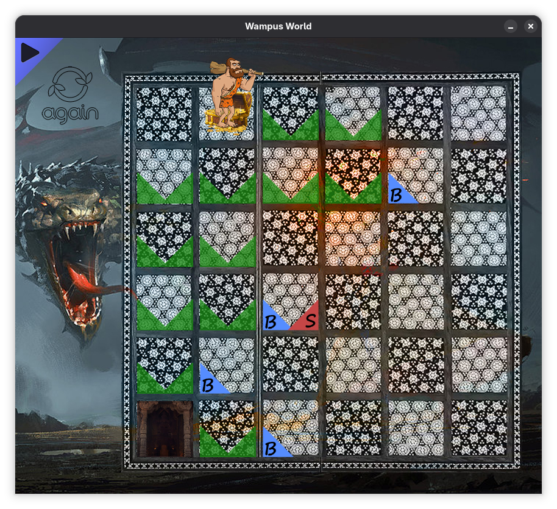
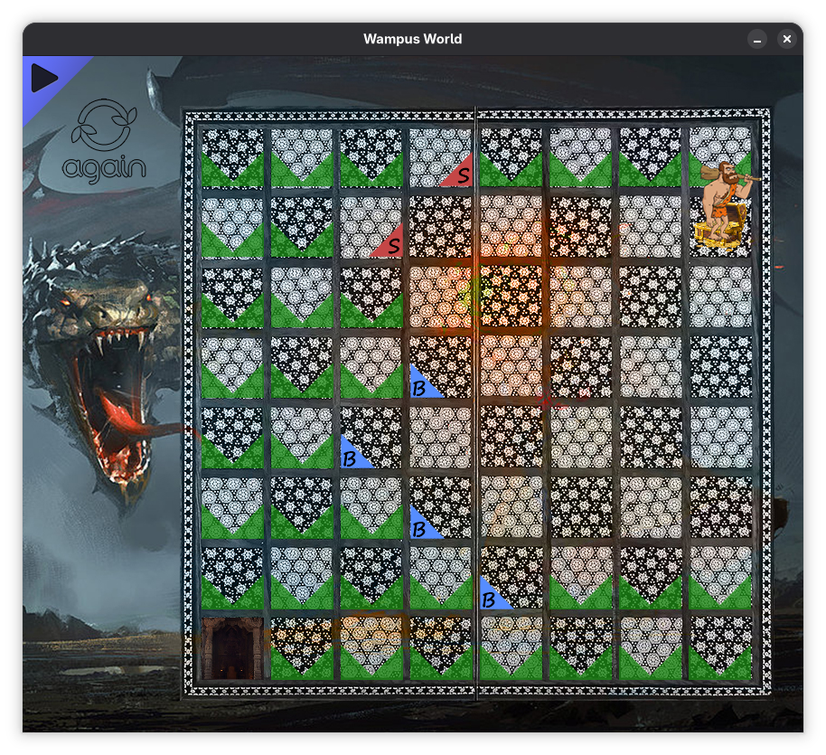

# Wumpus World

I developed this game during the Spring semester of 2018 as part of my _Artificial Intelligence and Expert Systems_ course. With only half a day to complete the project, the auto-search implementation is basic and not based on any algorithm.

I programmed the game using Java, and built its graphical user interface with JavaFX and Adobe Photoshop. 

Players can choose to play on a grid ranging from 4×4 up to 8×8. They also have the option to enable auto mode, allowing the computer to play on their behalf.

To run the game, compile it into the bin directory and run it from there, with the JavaFX SDK on the module path:
```bash
javac --module-path /path-to-your-javafx-directory/openjfx/lib --add-modules=javafx.controls -d bin src/*.java
cd bin
java --module-path /path-to-your-javafx-directory/openjfx/lib --add-modules=javafx.controls Main
```



